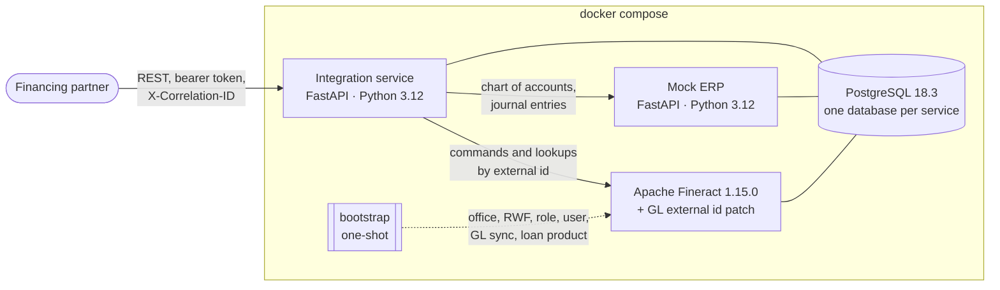
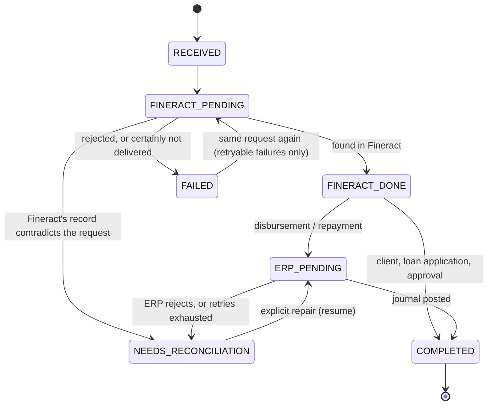

# Architecture

## Components



| Component | Owns | Does not own |
| --- | --- | --- |
| **ERP** | The chart of accounts (master data) and the accounting journal | Loans, balances |
| **Fineract** | Clients, loans, disbursements, repayments, balances: the system of record for money | The chart of accounts (it mirrors the ERP's) |
| **Integration service** | The partner API, idempotency, the identity mapping (`client_uid`, `loan_reference` ↔ Fineract ids), the lifecycle of each request | Any balance or business rule Fineract already enforces |

The integration service never computes money. Interest and the split of a repayment come from Fineract, and journal
entries are derived from what Fineract recorded.

## Data flow

**GL accounts (Part A).**
`POST /api/accounts/sync` reads the ERP's chart and creates each account in Fineract with
`externalId = <ERP external_reference>`. The patched Fineract makes that create idempotent. Each account is tracked
`SYNC_PENDING → SYNCED` or `FAILED`, and recovery retries transient failures. The bootstrap runs the sync before it
creates the loan product, because the product references the synced accounts by their Fineract ids. It looks those
ids up with `GET /glaccounts/external-id/{id}`.

**Partner operations (Parts C–F).** Client creation, loan application, approval, disbursement and repayment take one
path:

```
request ─▶ validate ─▶ claim (type, external_reference) ─▶ executor ─▶ response
                          │                                   │
                          └ replay / in progress / conflict   ├ Fineract: look up, submit if absent, confirm
                                                              └ ERP (money only): post the journal derived from Fineract
```

**Recovery (Part J).** A sweep runs at startup, every 5 s, and on `POST /api/admin/recovery`. It resumes operations
whose owner died (lease expired) or whose backoff has elapsed. It runs the **same executor** as the request did.

**Reconciliation (Part K).** A read-only comparison of the Fineract transactions on every loan the integration
originated with the ERP's journal entries, keyed by `external_reference`.

## Data model (integration database)

| Table | Purpose | Key constraints |
| --- | --- | --- |
| `operations` | One row per state-changing request. It is the idempotency record, the state machine and the work queue. | `UNIQUE (type, external_reference)`; partial `UNIQUE (type, loan_reference) WHERE type IN ('LOAN_APPROVAL','DISBURSEMENT') AND status <> 'FAILED'` |
| `clients` | `client_uid` ↔ Fineract client id | `UNIQUE client_uid`, `UNIQUE external_reference` |
| `loans` | `loan_reference` ↔ Fineract loan id, application terms | `UNIQUE loan_reference`, `UNIQUE external_reference`, FK to `clients` |
| `loan_transactions` | A disbursement or repayment exactly as Fineract recorded it (amount and portions), plus the ERP entry number | `UNIQUE external_reference`, FK to `loans` |
| `gl_account_syncs` | ERP account ↔ Fineract GL account, with sync status | `UNIQUE external_reference`, `UNIQUE code` |
| `loan_reference_seq` | Issues `LN-<year>-<n>` | sequence |

An operation stores:

* the request itself (JSON), so recovery can resume without the original HTTP request;
* the request's SHA-256 fingerprint, with amounts normalized so `5000000` equals `5000000.00`;
* the stored result or error, which a replay returns;
* the correlation id;
* `attempts` and `next_attempt_at`, the backoff schedule;
* `lease_owner` and `lease_expires_at`, which name the current owner and until when;
* `version`, for optimistic locking: every write checks it, so a former owner can never overwrite a newer state.

The schema is an Alembic migration. A test fails if the models and the migrations drift apart.

Fineract's numeric ids are stored only in `fineract_*_id` columns. They appear in logs, never in the API.

## State machine



| Status | Meaning | What is safe to do next |
| --- | --- | --- |
| `RECEIVED` | Claimed; Fineract not called yet | Execute |
| `FINERACT_PENDING` | A Fineract call may have happened | **Look up first**, by external id. Submit only if absent. Never mark FAILED unless it is certain nothing was delivered. |
| `FINERACT_DONE` | Fineract recorded it (stored locally) | Post the journal; never call Fineract again |
| `ERP_PENDING` | Waiting for the ERP posting (backoff) | Post the identical journal again (the ERP is idempotent) |
| `COMPLETED` | Done | Replay the stored result |
| `FAILED` | Definitive rejection (`retryable=false`), or nothing reached Fineract (`retryable=true`) | Replay the error. A retryable failure re-executes when the same request is sent again. |
| `NEEDS_RECONCILIATION` | A human must decide | Visible in `GET /api/admin/operations`. If Fineract's side is recorded, `POST /api/admin/operations/{type}/{ref}/resume` re-drives the ERP posting. |

Every transition is committed **before** the next external call, and the allowed transitions are enforced in code
(`domain/operations.py`). A crash at any point therefore leaves a status that says exactly what is known.

### The executor

`services/executor.py` is the only code that changes an operation's status. The request that created an operation
runs it first; recovery resumes it. Every Fineract step is:

1. **Find**: `GET` by external id (client: `/clients/external-id/{client_uid}`; loan:
   `/loans/external-id/{loan_reference}`; money: `/loans/external-id/{loan}/transactions/external-id/{ref}`).
2. **Submit**, only if not found. The command carries the external id (`externalId` on the client, loan or
   transaction), so Fineract's unique indexes are the last line of defence.
3. **Confirm**: find again. The stored record is Fineract's, not the request's.

Failures are classified by `gateways/http.py`:

| Outcome | Examples | Executor response |
| --- | --- | --- |
| Not applied | connection refused, connect timeout, 429, 503, a Fineract 409 lock conflict, any failed read | Back off and retry (3 attempts). Then FAILED, retryable, unless an earlier attempt's outcome was unknown. |
| Rejected | 4xx | Look once more (our own earlier attempt may be what Fineract refused as a duplicate). Then FAILED, not retryable, and release reserved keys. |
| Outcome unknown | read timeout, dropped connection, 500, 502, 504 | Back off and retry, starting with the lookup. If unresolved, stay FINERACT_PENDING and defer to recovery. |

Retry policy:

* **Within the request:** Fineract is tried 3 times, with 0.5 s then 1 s backoff.
* **In the background:** recovery retries with capped exponential backoff: 2 s, 4 s, 8 s and so on, up to 300 s, for at
  most 20 attempts, so an outage of up to about an hour heals by itself. After that the operation becomes
  NEEDS_RECONCILIATION.

A failed lookup proves nothing, but its meaning depends on when it happens:

* **Before** anything was submitted, it is "not applied".
* **After** a submit (the confirmation step), it is an **unknown outcome**: the command reached Fineract.

An unexpected failure, such as an unparseable answer, is deferred with backoff like an unknown outcome, never
concluded.

## Concurrency and the "exactly once" layers

| Layer | Stops | Why it is not enough alone |
| --- | --- | --- |
| 1. `UNIQUE (type, external_reference)` + fingerprint | The same reference processed twice. In-flight duplicates get 202, finished ones 200. | Different references for one loan pass |
| 2. Partial unique index, one active approval/disbursement per loan | Different references disbursing one loan (409) | Lives only in our database, and a FAILED row frees the slot |
| 3. Lookup by external id before submit; Fineract's unique `external_id` on clients, loans and loan transactions | Resubmitting what may already have been applied | Dedupes one reference only |
| 4. **Fineract's loan state** (the last line of defence) | A second disbursement of a single-tranche loan, whatever the integration believes | It is the system of record: it decides |

Leases make one executor at a time responsible for an operation, without holding a database lock across an HTTP
call:

* A lease is taken with an atomic conditional `UPDATE` that sets an owner token and an expiry by the database's wall
  clock (`clock_timestamp()`).
* It is renewed before every external call.
* It is released only by its owner's token.
* Every write to the operation checks its `version` (SQLAlchemy optimistic locking). An executor whose lease expired
  and was taken over fails at its next write and stops; it cannot overwrite or release the new owner's work.
  Fineract's lookup-first rule makes even its last in-flight command harmless.

## GL sync design

### Fineract side (Java)

The patch extends the existing `GLACCOUNT/CREATE` command. That keeps Fineract's permission check, maker-checker,
audit trail and command retry. The external id is unique (Liquibase changeset `0242`). An identical replay returns
the existing account; a different definition gets 409 from a dedicated exception mapper.

A create that loses a unique-constraint race throws a `ConcurrencyFailureException` subclass, so Fineract's command
retry re-runs it in a fresh transaction, where it resolves against the committed winner. Details:
[fineract-customization/README.md](fineract-customization/README.md).

### Integration side (Python)

* **Trigger:** an explicit call, `POST /api/accounts/sync`.
* **Mapping:** the type mapping is one tested function (`domain/gl_accounts.py`).
* **Statuses:** each account is a `gl_account_syncs` row, locked during its sync so concurrent syncs take turns.
* **Retries:** transient failures get a backoff schedule that recovery honours. A rejection (409, unknown type) is
  FAILED without retry.

## Observability

Every service logs JSON lines with the same fields:

* `timestamp`;
* `correlation_id`;
* `external_reference`, `client_uid`, `loan_reference`;
* `fineract_transaction_id`, `erp_transaction_id`;
* `status`.

The correlation id comes from the partner's `X-Correlation-ID` header or is minted. It is echoed on every response
(including errors) and forwarded to the ERP and Fineract. It is also stored on the operation, so recovery logs its
work under the partner's original correlation id. [DECISIONS.md](DECISIONS.md#what-happened-to-fin-2026-000001)
shows the trail of one reference.
