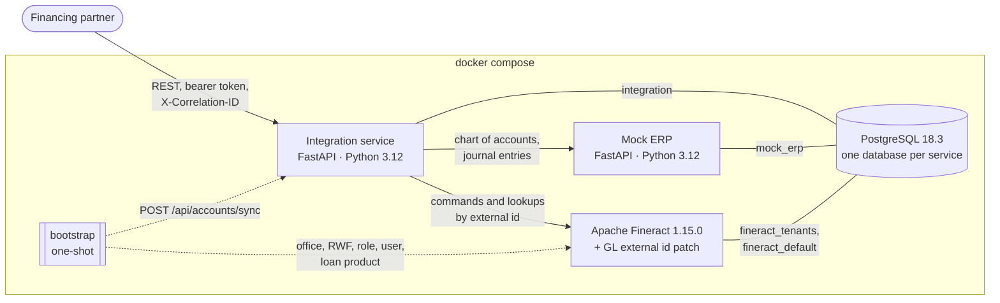
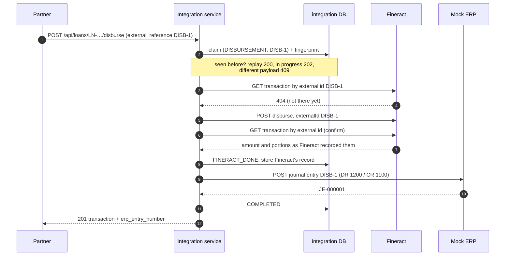
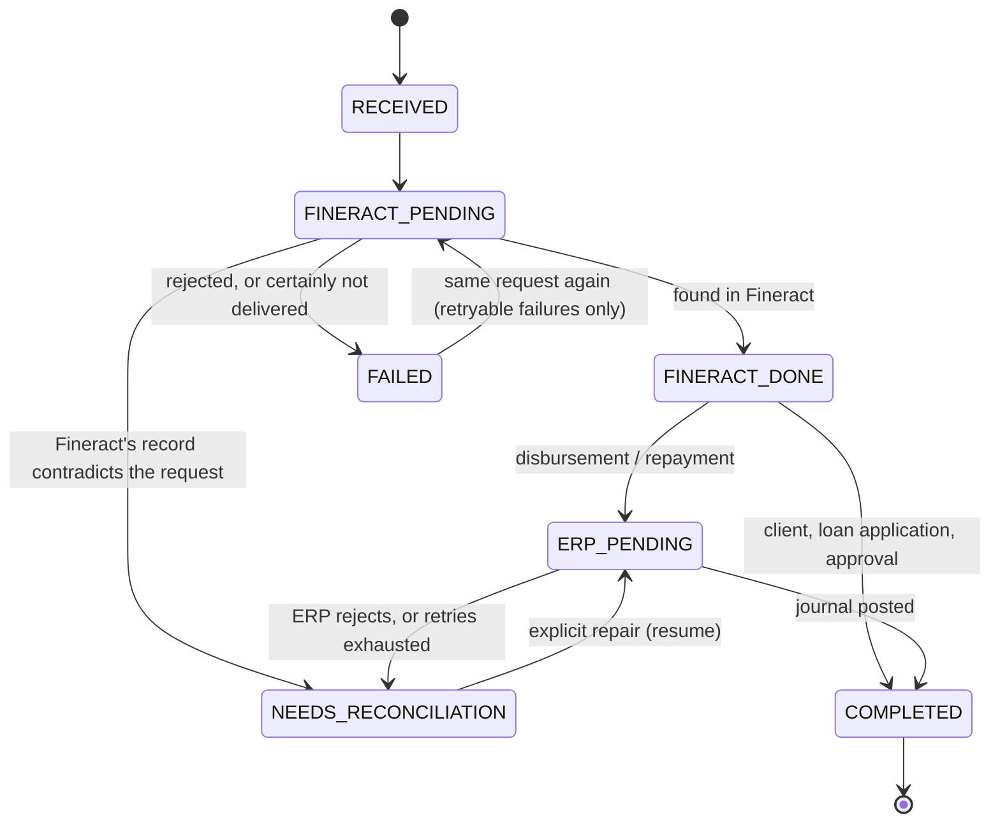

# Architecture

## Components

| Component | Owns | Does not own |
| --- | --- | --- |
| **ERP** | The chart of accounts (master data) and the accounting journal | Loans, balances |
| **Fineract** | Clients, loans, disbursements, repayments, balances: the system of record for money | The chart of accounts (it mirrors the ERP's) |
| **Integration service** | The partner API, idempotency, the identity mapping (`client_uid`, `loan_reference` ↔ Fineract ids), the lifecycle of each request | Any balance or business rule Fineract already enforces |

The integration service never computes money. Interest and the split of a repayment come from Fineract, and journal
entries are derived from what Fineract recorded.

## Data flow

**GL accounts (Part A).**
`POST /api/accounts/sync` reads the ERP's chart and creates each account in Fineract with
`externalId = <ERP external_reference>`. The patched Fineract makes that create idempotent. Each account is tracked
`SYNC_PENDING → SYNCED` or `FAILED`, and recovery retries transient failures. The bootstrap runs the sync before it
creates the loan product, because the product references the synced accounts by their Fineract ids. It looks those
ids up with `GET /glaccounts/external-id/{id}`.

**Partner operations (Parts C–F).** Client creation, loan application, approval, disbursement and repayment take one
path. A disbursement, end to end:

Each status is committed before the next external call. If anything fails part-way, the row says exactly how far it
got, and recovery continues from there with the same steps.

**Recovery (Part J).** A sweep runs at startup, every 5 s, and on `POST /api/admin/recovery`. It resumes operations
whose owner died (lease expired) or whose backoff has elapsed. It runs the **same executor** as the request did.

**Reconciliation (Part K).** A read-only comparison of the Fineract transactions on every loan the integration
originated with the ERP's journal entries, keyed by `external_reference`.

## Accounting mapping (Part H)

The journal entry is derived from Fineract's transaction, never from our own arithmetic. Fineract decides how a
repayment splits into principal, interest, fees and penalties (its repayment schedule and allocation rule). The
integration reads that split back from the transaction it recorded (`principalPortion`, `interestPortion`,
`feeChargesPortion`, `penaltyChargesPortion`, `overpaymentPortion`) and copies it into the entry.

The mapping is one pure function, `journal_entry_for` in `integration-service/src/integration_service/domain/accounting.py`,
unit-tested in `tests/unit/test_accounting.py`.

| Fineract transaction | Debit | Credit |
| --- | --- | --- |
| Disbursement | 1200 Loan Receivable (amount) | 1100 Bank (amount) |
| Repayment | 1100 Bank (amount) | 1200 Loan Receivable (principal portion) |
| | | 4000 Interest Income (interest portion) |
| | | 4100 Fee Income (fee portion) |
| | | 4200 Penalty Income (penalty portion) |
| | | 2100 Overpayment Liability (overpayment portion) |

A credit line appears only when its portion is above zero. If the portions don't add up to the amount, the
function refuses to build an entry, and the operation goes to NEEDS_RECONCILIATION instead of posting an unbalanced or
guessed journal.

**Overpayments.** When a partner pays more than is owed, Fineract books the excess as `overpaymentPortion` and keeps
it as a liability to the client. The entry credits 2100 Overpayment Liability with it, the same account the loan
product maps for overpayments, so both ledgers show the money is owed back.

**Reversals.** `POST /api/loans/{loan}/repayments/{repayment}/reversal` is an operation like the others
(`REPAYMENT_REVERSAL`), with the same state machine and lookup-before-submit rule:

1. Fineract undoes the repayment. It keeps the transaction, marks it reversed, and stores our reversal reference on
   it (`reversalExternalId`), so a lost answer is resolved by looking the repayment up, never by undoing it twice.
2. The ERP gets the repayment's own entry with every debit and credit swapped (`reversing_entry`, a pure function),
   posted as `{repayment}:REVERSAL`. The ERP is unique on that reference: one reversing entry per repayment, whatever
   the reversal is called.
3. Reconciliation reports the pair as `MATCHED`: reversed in Fineract, entry plus reversing entry in the ERP.

A reversal made directly in Fineract, outside the API, has no reversing entry, so reconciliation reports
`AMOUNT_MISMATCH` with a note: Fineract nets to zero and the ERP does not.

**The chart.** The ERP seeds these accounts, and the bootstrap maps the loan product to them through their external
ids (`GL-1100` …):

| Code | Name | Type | Fineract product mapping |
| --- | --- | --- | --- |
| 1100 | Bank | Asset | Fund source |
| 1200 | Loan Receivable | Asset | Loan portfolio |
| 1300 | Transfers in Suspense | Asset | Transfers in suspense |
| 2100 | Overpayment Liability | Liability | Overpayment liability |
| 4000 | Interest Income | Income | Interest on loans |
| 4100 | Fee Income | Income | Income from fees |
| 4200 | Penalty Income | Income | Income from penalties |
| 4300 | Recovery Income | Income | Income from recovery |
| 5100 | Loan Write-off Expense | Expense | Losses written off |

ERP account types map to Fineract's GL types in one tested function, `fineract_gl_type` in
`domain/gl_accounts.py`: Asset → 1, Liability → 2, Equity → 3, Income → 4, Expense → 5.

## Data model (integration database)

| Table | Purpose | Key constraints |
| --- | --- | --- |
| `operations` | One row per state-changing request. It is the idempotency record, the state machine and the work queue. | `UNIQUE (type, external_reference)`; partial `UNIQUE (type, loan_reference) WHERE type IN ('LOAN_APPROVAL','DISBURSEMENT') AND status <> 'FAILED'` |
| `clients` | `client_uid` ↔ Fineract client id | `UNIQUE client_uid`, `UNIQUE external_reference` |
| `loans` | `loan_reference` ↔ Fineract loan id, application terms | `UNIQUE loan_reference`, `UNIQUE external_reference`, FK to `clients` |
| `loan_transactions` | A disbursement or repayment exactly as Fineract recorded it (amount and portions), plus the ERP entry number | `UNIQUE external_reference`, FK to `loans` |
| `gl_account_syncs` | ERP account ↔ Fineract GL account, with sync status | `UNIQUE external_reference`, `UNIQUE code` |
| `loan_reference_seq` | Issues `LN-<year>-<n>` | sequence |

An operation row stores:

| Column(s) | Why |
| --- | --- |
| `request` (JSON) | Recovery can resume without the original HTTP request |
| `request_fingerprint` | SHA-256 of the canonical request, so `5000000` equals `5000000.00` |
| `result` / `error` | What a replay returns |
| `correlation_id` | Recovery logs under the partner's original id |
| `attempts`, `next_attempt_at` | The backoff schedule |
| `lease_owner`, `lease_expires_at` | Who is working on it, and until when |
| `version` | Optimistic locking: a former owner can never overwrite a newer state |

The schema is an Alembic migration. A test fails if the models and the migrations drift apart.

Fineract's numeric ids are stored only in `fineract_*_id` columns. They appear in logs, never in the API.

## State machine

| Status | Meaning | What is safe to do next |
| --- | --- | --- |
| `RECEIVED` | Claimed; Fineract not called yet | Execute |
| `FINERACT_PENDING` | A Fineract call may have happened | **Look up first**, by external id. Submit only if absent. Never mark FAILED unless it is certain nothing was delivered. |
| `FINERACT_DONE` | Fineract recorded it (stored locally) | Post the journal; never call Fineract again |
| `ERP_PENDING` | Waiting for the ERP posting (backoff) | Post the identical journal again (the ERP is idempotent) |
| `COMPLETED` | Done | Replay the stored result |
| `FAILED` | Definitive rejection (`retryable=false`), or nothing reached Fineract (`retryable=true`) | Replay the error. A retryable failure re-executes when the same request is sent again. |
| `NEEDS_RECONCILIATION` | A human must decide | Visible in `GET /api/admin/operations`. If Fineract's side is recorded, `POST /api/admin/operations/{type}/{ref}/resume` re-drives the ERP posting. |

Every transition is committed **before** the next external call, and the allowed transitions are enforced in code
(`domain/operations.py`). A crash at any point therefore leaves a status that says exactly what is known.

### The executor

`services/executor.py` is the only code that changes an operation's status. The request that created an operation
runs it first; recovery resumes it. Every Fineract step is:

1. **Find**: `GET` by external id (client: `/clients/external-id/{client_uid}`; loan:
   `/loans/external-id/{loan_reference}`; money: `/loans/external-id/{loan}/transactions/external-id/{ref}`).
2. **Submit**, only if not found. The command carries the external id (`externalId` on the client, loan or
   transaction), so Fineract's unique indexes are the last line of defence.
3. **Confirm**: find again. The stored record is Fineract's, not the request's.

Failures are classified by `gateways/http.py`:

| Outcome | Examples | Executor response |
| --- | --- | --- |
| Not applied | connection refused, connect timeout, 408, 429, 503, a Fineract 409 lock conflict, any failed read | Back off and retry (3 attempts). Then FAILED, retryable, unless an earlier attempt's outcome was unknown. |
| Not applied, and a configuration problem | 401, 407, Fineract's 403 `error.msg.not.authorized` (a missing permission) | As above, logged as an error. Reserved keys are kept, so the same request succeeds once the credentials are fixed. |
| Rejected | any other 4xx, including Fineract's 403 for a broken business rule | Look once more (our own earlier attempt may be what Fineract refused as a duplicate). Then FAILED, not retryable, and release reserved keys. |
| Outcome unknown | read timeout, dropped connection, 500, 502, 504, and anything unexpected (an answer that can't be parsed) | Back off and retry, starting with the lookup. If unresolved, defer to recovery, which counts the attempt. Never FAILED. |

Retry policy:

* **Within the request:** Fineract is tried 3 times, with 0.5 s then 1 s backoff.
* **In the background:** recovery retries with capped exponential backoff: 2 s, 4 s, 8 s and so on, up to 300 s, for at
  most 20 attempts, so an outage of up to about an hour heals by itself. After that the operation becomes
  NEEDS_RECONCILIATION.

A failed lookup before submitting means "not applied". After submitting, it means "outcome unknown", because the
command may have reached Fineract. Anything unexpected, such as an answer that can't be parsed, is treated as an
unknown outcome too: deferred with backoff, never concluded.

## Concurrency and the "exactly once" layers

| Layer | Stops | Why it is not enough alone |
| --- | --- | --- |
| 1. `UNIQUE (type, external_reference)` + fingerprint | The same reference processed twice. In-flight duplicates get 202, finished ones 200. | Different references for one loan pass |
| 2. Partial unique index, one active approval/disbursement per loan | Different references disbursing one loan (409) | Lives only in our database, and a FAILED row frees the slot |
| 3. Lookup by external id before submit; Fineract's unique `external_id` on clients, loans and loan transactions | Resubmitting what may already have been applied | Dedupes one reference only |
| 4. **Fineract's loan state** (the last line of defence) | A second disbursement of a single-tranche loan, whatever the integration believes | It is the system of record: it decides |

**Leases: one worker per operation at a time.** The request that created an operation and the recovery sweep could
both try to work on it. A lease decides who may, without holding a database lock during HTTP calls:

| Step | How |
| --- | --- |
| Take | One conditional `UPDATE` sets an owner token and an expiry, using the database clock (`clock_timestamp()`) |
| Keep | Renewed before each external call |
| Give back | Released only with the owner's token |
| Lose | Every write checks the row's `version` (optimistic locking). A worker whose lease expired and was taken over fails at its next write and stops. Because every attempt starts with a Fineract lookup, even a command it already sent can't be applied twice. |

## GL sync design

### Fineract side (Java)

GL accounts get a unique external id, enforced inside Fineract's own create command: an identical replay returns the
existing account and a different definition gets 409, even under concurrent creates. See
[fineract-customization/README.md](fineract-customization/README.md).

### Integration side (Python)

* **Trigger:** an explicit call, `POST /api/accounts/sync`.
* **Mapping:** the type mapping is one tested function (`domain/gl_accounts.py`).
* **Statuses:** each account is a `gl_account_syncs` row, locked during its sync so concurrent syncs take turns.
* **Retries:** transient failures get a backoff schedule that recovery honours. A rejection (409, unknown type) is
  FAILED without retry.

## Observability

Every service logs one JSON object per line, with the fields `timestamp`, `correlation_id`, `external_reference`,
`client_uid`, `loan_reference`, `fineract_transaction_id`, `erp_transaction_id` and `status`.

The correlation id comes from the partner's `X-Correlation-ID` header or is minted. It is echoed on every response
(including errors) and forwarded to the ERP and Fineract. It is also stored on the operation, so recovery logs its
work under the partner's original correlation id. [DECISIONS.md](DECISIONS.md#what-happened-to-fin-2026-000001)
shows the trail of one reference.
